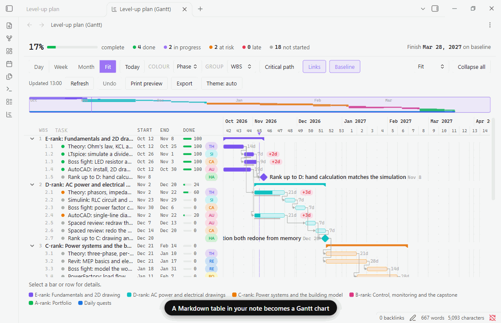
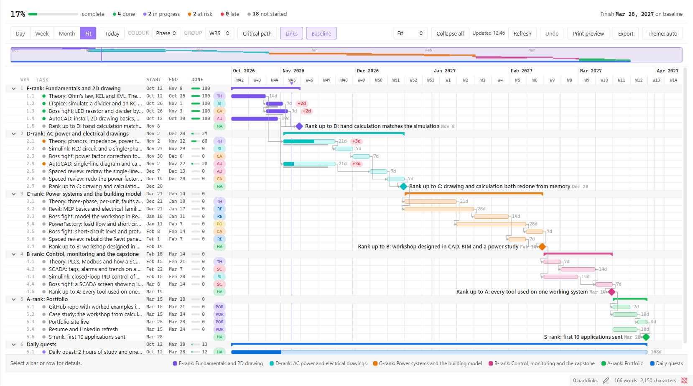
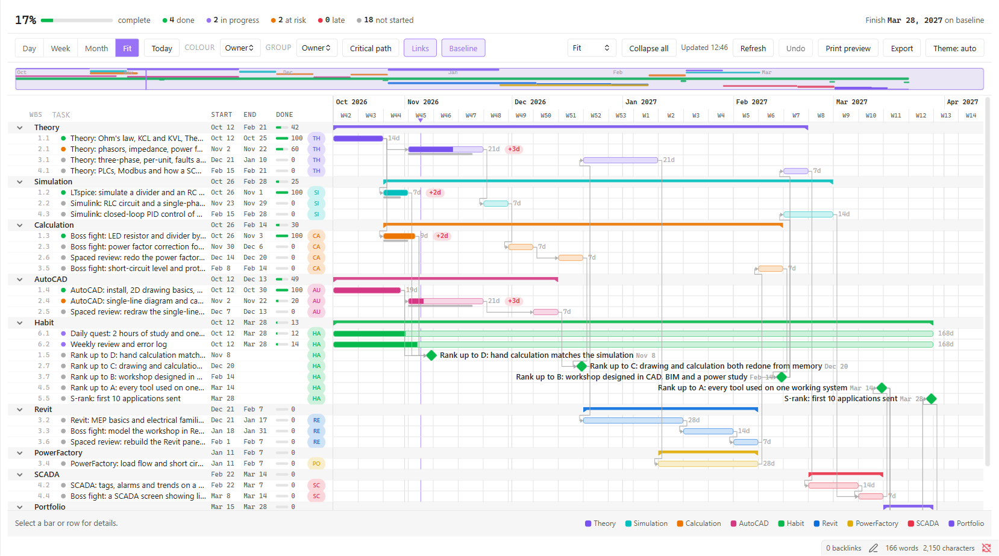
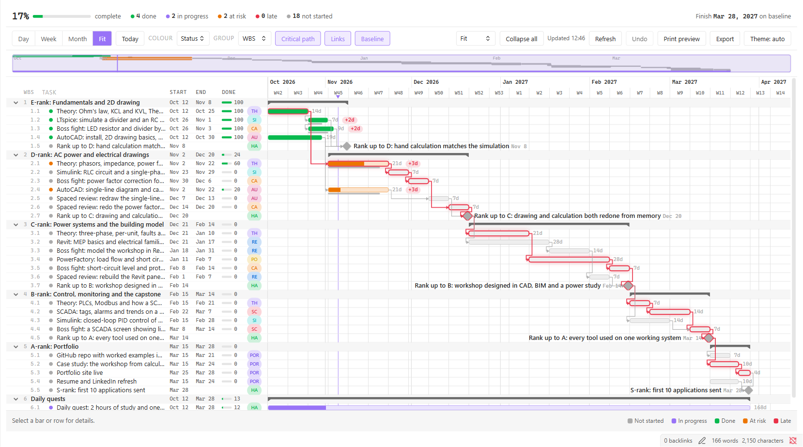
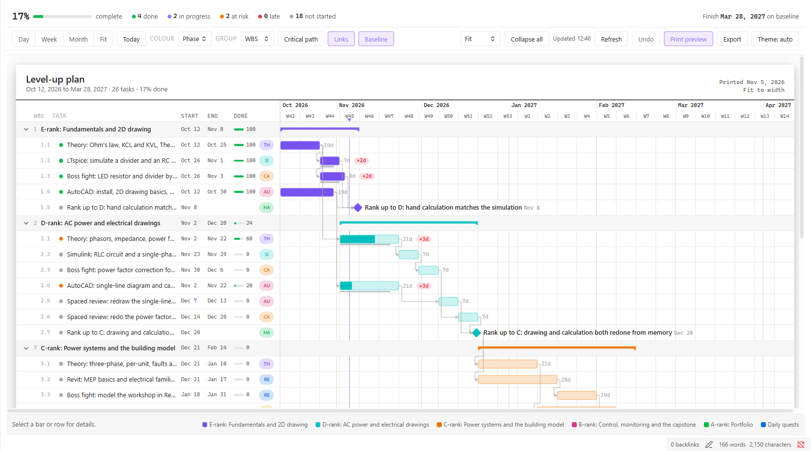

# Ganttable

Turn a Markdown table into a printable Gantt chart. The table in your note is the plan, and the chart is a view of it.

> Version 0.5.0 (beta). Chart with links, critical path, baseline, print preview, SVG and PNG export, and drag-to-edit with undo. Tested on desktop and in Obsidian's mobile mode; please report anything odd on a real phone.





| Group by area | Critical path | Print preview |
| --- | --- | --- |
|  |  |  |

## How it works

1. Put a table in a note. Ganttable looks for the columns **Task** and **Start**.
2. Add a ```` ```gantt ```` code block below it. It shows a summary card with an **Open gantt** button.
3. The button opens the full chart in its own tab. Edit the table and the chart follows.

Run the command **Insert gantt template** to start from an example.

## The table

| Column | Purpose |
| --- | --- |
| WBS | Outline number: `1`, `1.1`, `1.2.1`. Parents roll up their children. Optional. |
| Task | Name. Start it with `◆`, `<>`, `(ms)` or `[ms]` to make it a milestone. |
| Start, End | Dates as `YYYY-MM-DD`. A blank End makes a one-day task. |
| Done | Percent complete. |
| After | WBS numbers of predecessors, for example `1.1, 2.3`. Drawn as arrows and used for the critical path. |
| Owner | Person responsible. |
| Baseline | The originally planned end date. A red chip shows how many days it has slipped. |

Header names are matched loosely, so `Finish`, `Due`, `Activity`, `Assigned to` and similar also work. Extra columns are ignored.

Problems such as a bad date or a duplicate WBS number are listed above the chart with their line number. The last good chart stays on screen while you fix them.

## Chart

The toolbar above the chart holds the same controls as the settings, and your choices are saved.

- **Zoom:** Day, Week, Month and Fit, with an overview strip you can drag (hide it in settings).
- **Colour:** by status, phase or owner. **Group:** by WBS or by owner.
- **Critical path, Links, Baseline:** outline the chain that sets the finish date, draw arrows from the After column, and mark each task's original finish with a red chip for the days slipped.
- **Row height:** compact, normal or roomy. **Collapse all** folds the summary rows.
- **Select a task** to dim everything outside its chain of links.
- **Print preview:** a light sheet fitted to the width, with a title block and legend.
- **Export:** save the chart next to the note as SVG or PNG.
- **Theme:** switch the chart between auto, light and dark without changing Obsidian's theme.
- **Live update** as you edit, with a Refresh button. Works on desktop and mobile.

## A worked example: learn, build, boss fight, review

Studying theory alone fades. [docs/concept.md](docs/concept.md) explains a plan where every skill gets a short theory block, a hands-on exercise, a boss-fight calculation for your portfolio, and a spaced review two weeks later. [docs/example-level-up-plan.md](docs/example-level-up-plan.md) is that plan for an electrical engineer: six months covering AutoCAD, Revit, LTspice and Simulink, PowerFactory and SCADA, ending in a portfolio. Copy it into a note and press **Open gantt**.

## Tweak the view

Everything in the toolbar is also a setting, and your choices are remembered.

| What | Where | Options |
| --- | --- | --- |
| Zoom | Toolbar | Day, week, month, fit to width |
| Row height | Toolbar or settings | Compact, normal, roomy, fit to window |
| Colour bars by | Toolbar or settings | Status, phase, owner (area) |
| Group rows by | Toolbar or settings | WBS, owner (area) |
| Links, baseline, critical path | Toolbar or settings | On or off |
| Overview strip | Settings | Show or hide |
| Task column width | Settings, or drag its edge | 280 to 720 pixels |
| Chart theme | Toolbar or settings | Follow Obsidian, light, dark |
| Drag bars to change dates | Settings | On or off |
| Push later tasks when moving | Settings | Off by default |
| Open gantt in | Settings | New tab, split, pop-up window (desktop) |

## Edit by dragging

Drag a bar to move it, or drag either edge to change its start or end. Drag a milestone to move it, or a summary row to move everything under it. The table in your note is rewritten when you let go.

- Only the Start and End cells of the rows you changed are touched. Your spacing and every other line stay as they are.
- A tooltip shows the new dates while you drag. Press Escape to cancel.
- Before writing, Ganttable checks that each row is still the one it drew. If the note changed in the meantime it refuses and asks you to refresh, so it never overwrites your edits.
- **Undo** (or Ctrl/Cmd+Z while the chart has focus) puts the note back, but only if nothing else has edited it since.
- On a touch screen, press and hold a bar for a moment before dragging, so swiping still scrolls the chart.
- Turn it off with **Drag bars to change dates** in the settings. Tasks that depend on a moved task are not moved with it.

## Roadmap

- 0.4: move dependent tasks along, finish-to-finish links, working calendar and holidays.

## Install

Until it is in the community list, install it with the BRAT plugin (add this repository), or copy `main.js`, `manifest.json` and `styles.css` from a release into `<vault>/.obsidian/plugins/ganttable/` and turn it on under Community plugins. It needs Obsidian 1.13 or newer.

An example plan to try is in [`docs/example-level-up-plan.md`](docs/example-level-up-plan.md). Copy it into a note and press Open gantt.

## Development

```sh
npm install
npm test          # unit tests
npm run build     # type check and bundle main.js
npm run dev       # rebuild on change
```

Copy `main.js`, `manifest.json` and `styles.css` into `<vault>/.obsidian/plugins/ganttable/` to try it.

## License

MIT
